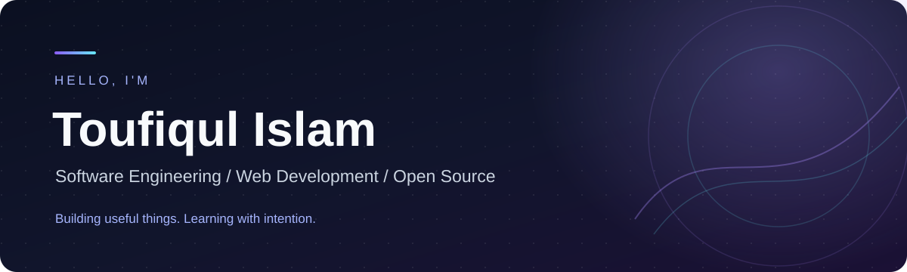

<div align="center">
  
  <h1>Personal Portfolio</h1>
  <p>A minimal, dark-themed developer portfolio built with HTML and CSS.</p>
  <p><a href="./p.html">Explore the source</a> · <a href="./profile/README.md">GitHub profile README template</a></p>
</div>

---

## Overview

This repository contains a responsive personal portfolio page featuring an introduction, skill highlights, project summaries, profile links and a contact section.

## Tech stack

`HTML5` · `CSS3` · `Google Fonts`

## Run locally

1. Clone or download this repository.
2. Open `p.html` in your browser.

For local hosting:

```bash
python -m http.server 8000
```

Visit `http://localhost:8000/p.html`.

## Structure

```text
portfolio-1/
├── assets/github-banner.svg   # Reusable profile/portfolio banner
├── profile/README.md          # GitHub profile template
├── ovi.jpg                    # Portfolio portrait
└── p.html                     # Website
```

## Improvements planned

- Improve keyboard accessibility and mobile navigation
- Publish a live demo with GitHub Pages
- Add screenshots and update project links

### Author

**Toufiqul Islam** · [GitHub](https://github.com/Toufiqul-27)
